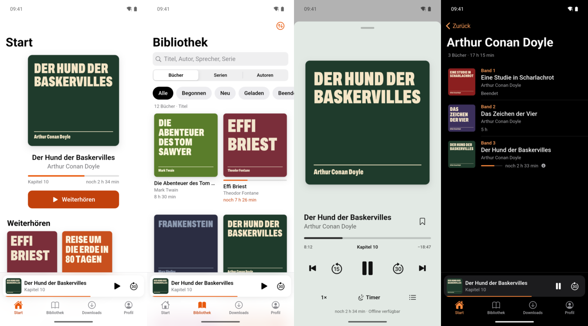

# Super-Papagei

Ein kleiner Hörbuch-Server für die eigene Sammlung auf dem NAS, mit eigener App für Android (und iPhone). Gedacht für Haushalte mit einer ordentlich sortierten Hörbuch-Bibliothek, die es schlicht und zuverlässig mögen.

*A small self-hosted audiobook server for your NAS with its own Flutter app. The UI is German.*



## Was es kann

- **Abspielen heißt laden:** Wer auf Abspielen tippt, bekommt das Buch sofort aufs Gerät. Bis der Download fertig ist, wird gestreamt, dann spielt die App nahtlos die lokale Datei.
- **Die Position geht nicht verloren:** Sie wird alle paar Sekunden lokal gesichert, auch offline, und mit dem Server abgeglichen. Beim Start holt die App zuerst die neueste Position, auch von anderen Geräten. Ein Positionsverlauf pro Buch hilft, falls doch einmal etwas springt.
- **Mehrere Personen:** jedes Konto mit eigenem Fortschritt, eigenen Lesezeichen und eigenem Profilbild.
- **Unterwegs:** Downloads nur im WLAN (umschaltbar), Wiedergabe auf dem Sperrbildschirm, in der Benachrichtigung und in **Android Auto**, inklusive Sprachsuche.
- **Abends:** Sleep-Timer mit sanftem Ausblenden, Ende des Kapitels, und Schütteln startet den Timer neu.
- **Wieder reinkommen:** Nach einer Pause springt die App ein paar Sekunden zurück, in selbst einstellbaren Stufen (z. B. ab 10 Minuten Pause 5 Sekunden).
- **Bibliothek:** große Cover, Serien in richtiger Reihenfolge, Autoren, Suche, Filter, helle und dunkle Darstellung.
- **Startseite:** Der Server zeigt im Browser eine kleine Seite mit gemaltem Papagei und dem App-Download.


## Wie die Bibliothek aussehen muss

Jeder Ordner direkt in der Bibliothek ist ein Buch:

```
Audiobooks/
  Arthur Conan Doyle - Der Hund der Baskervilles/
    Der Hund der Baskervilles.mp3
    cover.jpg
  Theodor Fontane - Effi Briest/
    01.mp3
    02.mp3
    cover.jpg
```

- Formate: MP3, M4B, M4A, AAC, OGG, Opus, FLAC. Mehrere Dateien werden in natürlicher Reihenfolge zu einem Buch.
- Titel, Autor, Sprecher, Serie mit Band, Beschreibung und Jahr kommen aus den Tags. Ohne Tags wird der Ordnername zum Titel.
- Kapitel kommen aus der Datei (M4B-Kapitel, MP3-Kapitelmarken) oder aus einer `.cue`-Datei.
- Cover: `cover.jpg`, `folder.jpg` oder `front.jpg`, sonst das eingebettete Bild.
- Ordner nicht umbenennen: Der Ordnername ist die Identität des Buchs, am Namen hängen Fortschritt und Lesezeichen.

## Server einrichten

### Mit Docker Compose

1. `server/docker-compose.yml` anpassen: Pfad zur Hörbuch-Freigabe, Benutzer-ID mit Lesezugriff, Admin-Name und erstes Passwort.
2. Starten:

   ```bash
   cd server && docker compose up -d --build
   ```

3. Test: `http://<NAS-IP>:8080/api/health` liefert `{"ok":true,…}`. Der erste Scan dauert je nach Bibliothek ein bis zwei Minuten.

### Fertiges Image

Ein fertiges Server-Image (ohne App) wird bei jeder Version gebaut: `ghcr.io/hendrikheidsiek/super-papagei`. Eine Klick-Anleitung für UGREEN-NAS steht in [docs/EINRICHTUNG-UGREEN.md](docs/EINRICHTUNG-UGREEN.md); auf anderen NAS mit Docker-Oberfläche funktioniert es genauso.

### Einstellungen (Umgebungsvariablen)

| Variable | Standard | Bedeutung |
|---|---|---|
| `ADMIN_USERNAME` | `admin` | Admin-Konto, wird nur beim allerersten Start angelegt |
| `ADMIN_PASSWORD` | zufällig | ohne Angabe steht ein Zufallspasswort einmalig im Container-Protokoll |
| `SERVER_NAME` | `Super-Papagei` | Name in der App |
| `SCAN_INTERVAL_MINUTES` | `30` | wie oft neue Bücher gesucht werden |
| `PUID` / `PGID` | – | Benutzer, unter dem der Server läuft |
| `PUBLIC_URL` | – | eigene Adresse, für Link-Vorschau und QR-Code der Startseite |
| `OPERATOR_NAME` / `OPERATOR_URL` | – | optionale Zeile „Betreiber dieser Seite“ auf der Startseite |

**Admin-Passwort vergessen?** Eine Datei `passwort-zuruecksetzen.txt` mit dem neuen Passwort (mindestens 8 Zeichen) in den Datenordner legen. Der Server setzt es innerhalb von 20 Sekunden und löscht die Datei.

### Von außen erreichbar machen

Hinter einen Reverse Proxy (z. B. Nginx Proxy Manager) mit HTTPS stellen. Für große Hörbücher die Pufferung abschalten:

```nginx
proxy_buffering off;
proxy_request_buffering off;
proxy_read_timeout 3600s;
proxy_send_timeout 3600s;
client_max_body_size 0;
```

Sicherheit: Alles außer Startseite, `/api/health` und `/api/app` braucht ein Login. Passwörter werden mit scrypt gespeichert, nach mehreren Fehlversuchen sperrt der Server die Anmeldung für einige Minuten.

## App bauen

Voraussetzungen: [Flutter](https://flutter.dev) und für Android das Android SDK.

```bash
cd app && flutter build apk --release --dart-define=DEFAULT_SERVER=https://audio.example.org
```

- `DEFAULT_SERVER` ist optional; ohne fragt die App beim Anmelden nach der Adresse.
- Für Updates über bestehende Installationen hinweg braucht es immer denselben Signaturschlüssel. Lege dazu `app/android/key.properties` an (Vorlage im Kommentar von `app/android/app/build.gradle.kts`) und bewahre den Schlüssel gut auf.
- iPhone: in Xcode `app/ios/Runner.xcworkspace` öffnen, eigenes Team und eigene Bundle-ID wählen, aufs Gerät spielen.

### Android Auto bei selbst installierter App

Android Auto zeigt im Auto-Startbildschirm nur Apps aus dem Play Store. Eine selbst installierte APK erscheint dort erst nach einer einmaligen Einstellung auf dem Handy (bis dahin taucht nur der Player auf, wenn die Wiedergabe schon auf dem Handy läuft):

1. **Einstellungen → Verbundene Geräte → Verbindungseinstellungen → Android Auto** öffnen (je nach Hersteller auch über die Suche in den Einstellungen nach „Android Auto“).
2. Ganz nach unten scrollen und etwa zehnmal auf **Version** tippen, die Frage nach den Entwicklereinstellungen bestätigen.
3. Oben rechts **⋮ → Entwicklereinstellungen** öffnen und **Unbekannte Quellen** einschalten.
4. Unter **Launcher anpassen** prüfen, dass Super-Papagei eingeschaltet ist.
5. Das Handy einmal vom Auto trennen und neu verbinden.

Danach steht Super-Papagei als eigene App im Auto, mit „Weiterhören“, heruntergeladenen Büchern, Bibliothek und Sprachsuche („Hey Google, spiele … in Super-Papagei“). Die Einstellung bleibt bei App-Updates erhalten.

### App über den Server verteilen

`server/release.sh <version>` baut die App, legt sie ins Server-Image und lädt es hoch. Die Startseite bietet sie dann zum Download an, und installierte Apps melden selbst, wenn es eine neue Version gibt. Eigene Werte (Image-Name, Server-Adresse, Betreiber) kommen in `server/release.local`:

```bash
IMAGE=ghcr.io/<github-name>/super-papagei-server
DEFAULT_SERVER=https://audio.example.org
PUBLIC_URL=https://audio.example.org
OPERATOR_NAME=example.org
OPERATOR_URL=https://example.org
```

## Entwicklung

```bash
cd server && python3 -m venv .venv && .venv/bin/pip install -r requirements.txt
```

```bash
cd server && LIBRARY_PATH=/pfad/zu/Audiobooks DATA_PATH=./data ADMIN_PASSWORD=test1234 .venv/bin/uvicorn app.main:app --port 8765
```

App im Simulator mit automatischem Test-Login (nur Debug-Builds):

```bash
cd app && flutter run --dart-define=HW_SERVER=http://localhost:8765 --dart-define=HW_USER=admin --dart-define=HW_PASS=test1234
```

Design-Grundlagen der App stehen in [DESIGN.md](DESIGN.md).

## Woher der Name kommt

Ein Papagei wiederholt, was er hört, wie ein Hörbuch. Und der Name ist eine Verbeugung vor einer bekannten Hörspielfolge. Dieses Projekt steht in keiner Verbindung zu deren Rechteinhabern.

Die Screenshots zeigen eine Demo-Bibliothek mit gemeinfreien Klassikern und selbst gestalteten Covern. Das Papagei-Bild und das Krächzen wurden mit KI erzeugt (Google Gemini, ElevenLabs).

## Mitmachen

Ein privates Hobbyprojekt, das ich öffentlich teile. Fehlerberichte und Verbesserungen sind willkommen, eine Antwort kann aber dauern.

## Lizenz

[GNU Affero General Public License v3.0](LICENSE). Wer den Server verändert und anderen als Dienst anbietet, muss die Änderungen ebenfalls veröffentlichen.
